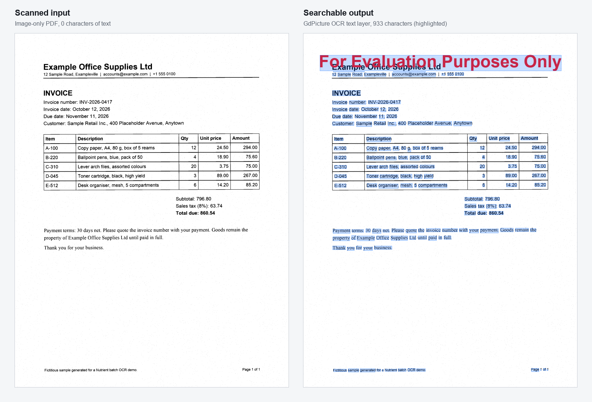
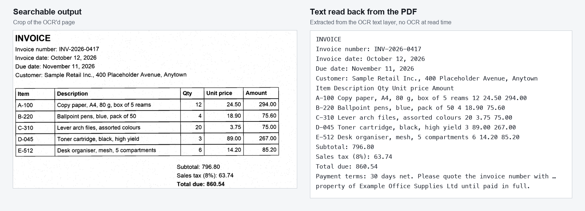

# Nutrient Batch OCR

A Nutrient.io demo that turns a folder of scanned PDFs into searchable PDFs with GdPicture.NET OCR, processing several files in parallel, and reports the throughput.



1. **Input.** Every `*.pdf` file in the input folder (top level only).
2. **Parallel processing.** Files are spread over several worker threads with a load-balancing partitioner. Each thread reuses its own `GdPicturePDF` instance.
3. **OCR.** `GdPicturePDF.OcrPages` adds an invisible text layer to every page, at the chosen resolution and language. The page images are untouched.
4. **Output.** Each file is saved as `OCR_<name>.pdf` in the output folder.
5. **Report.** One line per file (pages, time, time per page), then totals: files and pages processed, average time per file and per page, a time projection for a larger batch, throughput in MB/s and success rate.

## Prerequisites

- .NET SDK 10
- Windows, macOS or Linux
- OCR dictionaries (`eng.traineddata` and any other language you need). They are not stored in this repository. Get them from one of these sources:
  - the [GdPicture.Resources](https://www.nuget.org/packages/GdPicture.Resources) NuGet package (`runtimes/any/native`); the tool finds it in the local NuGet cache (`~/.nuget/packages/gdpicture.resources`) if it is there;
  - <https://github.com/tesseract-ocr/tessdata_fast>.

  Otherwise pass the folder with `--resources` or `OCR_RESOURCES_PATH`.

## Environment variables

Keys are only read from environment variables, never from code. Start from `.env.example`. Command-line options win over environment variables.

| Variable | Purpose | Default |
|---|---|---|
| `GDPICTURE_LICENSE_KEY` | GdPicture.NET license key | empty = evaluation mode |
| `OCR_INPUT_DIR` | Folder with the PDFs to OCR | `samples` |
| `OCR_OUTPUT_DIR` | Folder for the searchable PDFs | `output` |
| `OCR_RESOURCES_PATH` | Folder with the `.traineddata` files | GdPicture.Resources in the NuGet cache |
| `OCR_LANGUAGE` | OCR language, for example `eng` or `eng+fra` | `eng` |

Relative paths are resolved against the current directory. In evaluation mode GdPicture stamps a watermark on each output page and a process can run for one hour. A rejected key falls back to evaluation mode with a message.

## Build and run

```bash
dotnet build BatchOcr.sln
```

```bash
set -a && source .env && set +a && dotnet run --project BatchOcr
```

```bash
dotnet run --project BatchOcr -- --input /path/to/scans --output /path/to/searchable --dpi 200 --threads 4
```

## Usage

| Option | Description | Default |
|---|---|---|
| `-i`, `--input DIR` | Folder with the PDFs to OCR | `samples` |
| `-o`, `--output DIR` | Folder for the searchable PDFs | `output` |
| `-r`, `--resources DIR` | Folder with the `.traineddata` files | GdPicture.Resources in the NuGet cache |
| `-l`, `--language LANG` | OCR language | `eng` |
| `--dpi N` | OCR resolution (50 to 600). Lower is faster, less accurate | `150` |
| `-t`, `--threads N` | Files processed in parallel | processors - 1 |
| `--estimate N` | Number of documents for the time projection | `10000` |
| `-h`, `--help` | Show the help | |

Each file is OCR'd with one internal OCR thread; parallelism comes from processing several files at once, which is more stable for large batches.

Output of a run on the three samples (evaluation mode, `--threads 2`, 150 DPI, Apple Silicon laptop):

```text
[1/3] invoice-0417.pdf                         OK - 1 pages - 4.94 s file (4.94 s/page file)
[2/3] maintenance-report-q3.pdf                OK - 2 pages - 7.58 s file (3.79 s/page file)
[3/3] service-letter-1020.pdf                  OK - 2 pages - 5.53 s file (2.76 s/page file)

Files processed: 3/3
Total pages processed: 5
Estimated time for 10,000 documents: 9h 41m 58s
Success rate: 100.0%
```

The output PDFs keep the scanned image and gain a text layer, so the text can be searched, selected and extracted:



## Samples

`samples/` holds three fictitious, image-only PDFs (1 to 2 pages each, 300 DPI, black and white, slightly rotated with scanner noise): an invoice, a service letter and a maintenance report. They contain no text layer. They are generated by `samples/generate_scanned_samples.py` (Pillow):

```bash
python3 -m venv .venv && .venv/bin/pip install -r samples/requirements.txt
```

```bash
.venv/bin/python samples/generate_scanned_samples.py
```

## Project layout

| Path | Content |
|---|---|
| `BatchOcr/Program.cs` | Parallel batch processing, OCR, statistics |
| `BatchOcr/OcrOptions.cs` | Command-line options and environment variables |
| `samples` | Fictitious scanned samples and their generator |
